# MediLink-DL: A Deep Learning-Guided, Bandwidth-Adaptive, and Secure Framework for Medical Image Transmission in Rural Telemedicine

[](file:///Users/mayanksoni/Desktop/MediLink-DL/tests)
[](https://enlisted-carve-spotting.ngrok-free.dev)
[](https://www.python.org/)
[](file:///Users/mayanksoni/Desktop/MediLink-DL/src/security.py)
[](file:///Users/mayanksoni/Desktop/MediLink-DL/data/real_cxr)
[](file:///Users/mayanksoni/Desktop/MediLink-DL/docs/MediLink_DL_DIP_Technical_Report.pdf)
[](file:///Users/mayanksoni/Desktop/MediLink-DL/docs/MEDILINK_DL_FINAL_PRESENTATION_AND_VIVA_MASTER_SCRIPT.md)
[](LICENSE)

---

## 🌐 Live Interactive Research Dashboard

The complete MediLink-DL clinical telemedicine pipeline, NIST SP 800-232 cryptographic benchmark lab, and mathematical diffusion verifier can be accessed live:

| Deployment | URL / Access | Description |
| :--- | :--- | :--- |
| **Primary Live Demo (Ngrok)** | [https://enlisted-carve-spotting.ngrok-free.dev](https://enlisted-carve-spotting.ngrok-free.dev) | **Recommended for viva & live tests**: Powered directly by Apple Silicon (M-series MPS GPU) with real-time inference on the complete Cohen et al. CXR dataset. *(Click "Visit Site" on first load)* |
| **24/7 Cloud Deployment (Render)** | [https://medilink-dl.onrender.com](https://medilink-dl.onrender.com) | Standalone cloud deployment configured via [`render.yaml`](render.yaml) and [`Procfile`](Procfile) for persistent 24/7 evaluation. |
| **Localtunnel Backup** | [https://tough-kings-do.loca.lt](https://tough-kings-do.loca.lt) | Tunnel password / IP: `61.1.116.213` |
| **Localhost** | `http://localhost:8080` | Local development and offline evaluation (`python3 src/web_app.py 8080`) |

---

## 1. Executive Summary & Research Identity

**MediLink-DL** is an academic research prototype engineered to resolve the triple bottleneck of **diagnostic fidelity, transmission latency, and cryptographic security** for digital radiography in resource-constrained rural telemedicine.

Rural primary healthcare centers (PHCs) lack on-site specialist radiologists and rely on fragile, bandwidth-throttled communication uplinks (2G/EDGE, weak 3G, or satellite links at 48–128 kbps). Transmitting uncompressed high-resolution digital radiographs (10–35 MB) is intractable over these channels, while standard uniform lossy compression degrades subtle diagnostic features.

MediLink-DL bridges these domains through an integrated cross-layer framework combining:
1. **Clinical Data Curation & Leakage-Free Stratification**: Evaluated on 166 real clinical chest radiographs across 110 patients (Cohen et al. COVID-19 dataset) with expert bilateral lung annotations from `imageannotation.ai`, strictly enforcing zero patient overlap across partitions ($\mathcal{P}_{\text{train}} \cap \mathcal{P}_{\text{val}} = \emptyset, \mathcal{P}_{\text{train}} \cap \mathcal{P}_{\text{test}} = \emptyset$).
2. **Deep Learning Diagnostic Localization & Differentiable Grad-CAM**: `MedicalResNet18` and `MedicalDenseNet121` backbones with a second-order differentiable Grad-CAM loss (`create_graph=True`), yielding a **+49.2% increase in continuous ROI Dice** (0.4764 $\to$ 0.7107) and **+59.7% in binarized IoU** over standard classification baselines.
3. **Kendall & Gal (CVPR 2018) Homoscedastic Uncertainty Optimization**: Implemented `AdaptiveLocalizationAwareLoss` which replaces manual heuristic hyperparameter guessing ($\lambda_{\text{loc}}, \beta$) with learnable homoscedastic uncertainty log-variance parameters ($\sigma_1^2, \sigma_2^2$), automatically balanced via PyTorch autograd and AdamW.
4. **Dual-Stream ROI-Aware Differential Compression**: Preserves high quantization fidelity ($q_{\text{roi}}=90$) in diagnostic lung fields while aggressively compressing background context ($q_{\text{bg}}=25$), achieving a **9.89x compression ratio** (89.89% wire bandwidth drop) with **ROI PSNR > 48.3 dB** and **ROI SSIM > 0.989** on genuine radiographs.
5. **Standardized & Lightweight Authenticated Encryption (AEAD)**: Production-grade NIST SP 800-38D AES-256-GCM, NIST SP 800-232 Ascon-AEAD128, and research prototype MLMC-128 with fresh nonces, AAD metadata binding, and **100% tamper detection** under bit-flip mutations.
6. **Prioritized Application-Layer Transport**: Min-heap packet scheduler prioritizes diagnostic ROI chunks ahead of background context, accelerating clinical triage availability to **0.328 seconds** (**>3.1x faster** than FIFO).
7. **Cross-Layer Multi-Objective Optimization**: Evaluated across 108 end-to-end parameter sets to extract **26 non-dominated Pareto configurations** balancing SSIM, payload size, triage latency, and cryptographic CPU cost.
8. **Cryptographic Diffusion Research Laboratory**: Independent symmetric-key cryptography testbed exploring linear diffusion transformations:
   - `PROPOSED-OIN-MDS`: $\operatorname{Had}(1,8,13,5)$ optimal parameter instantiation ($\mathcal{B}_{\text{nibble}}=5, \mathcal{B}_{\text{bit}}=8, M^2=I$, 48 Paar XORs).
   - `ABC-MDS-OPT`: Alternating Block-Circulant involutory MDS (64 direct / 49 Paar XORs, $\mathcal{B}_{\text{bit}}=6, \mathcal{B}_{\text{nibble}}=5$).
   - `ABC-MDS-MAXBIT`: Alternating Block-Circulant involutory MDS (94 direct / 58 Paar XORs, $\mathcal{B}_{\text{bit}}=7, \mathcal{B}_{\text{nibble}}=5$).
   - `TBOI-16`: Tensor-Product Binary Orthogonal Involution ($K_4 \otimes K_4$, 60 Paar XORs, $\mathcal{B}_{\text{bit}}=6, \mathcal{B}_{\text{nibble}}=4$, Near-MDS).
   - Formal Impossibility Verifications: Hankel non-existence (Theorem 1), Cauchy field collapse (Proposition 2), and Galois matrix symmetry obstruction (Theorem 3).

> [!IMPORTANT]
> **Academic and Clinical Disclaimer**: MediLink-DL is an academic research and engineering prototype. It is not approved by the US FDA, EU CE-MDR, or CDSCO for primary diagnostic imaging. Experimental research primitives (MLMC / ABC-MDS) are strictly isolated from clinical patient data handling.

---

## 2. System Architecture & Data Flow

```mermaid
flowchart LR
    A["Raw Clinical CXR<br/>(512x512 Grayscale)"] --> B["MedicalResNet18<br/>Inference"]
    B --> C["Differentiable Grad-CAM<br/>Autograd Saliency"]
    C --> D["Dual-Stream JPEG<br/>(q_roi=90, q_bg=25)"]
    D --> E["AEAD Envelope<br/>(AES-256-GCM / Ascon / MLMC)"]
    E --> F["Priority Scheduler<br/>(Header > ROI > BG)"]
    F --> G["Rural Lossy Channel<br/>(48-128 kbps, 5% drop)"]
    G --> H["Receiver Reassembly<br/>& AEAD Verification"]
    H --> I["Reconstructed CXR<br/>(ROI PSNR > 48.3 dB)"]
```



For complete technical specifications, see [`docs/SYSTEM_ARCHITECTURE.md`](docs/SYSTEM_ARCHITECTURE.md), [`docs/IMPLEMENTATION_DETAILS.md`](docs/IMPLEMENTATION_DETAILS.md), and the compiled [`docs/MediLink_DL_DIP_Technical_Report.pdf`](docs/MediLink_DL_DIP_Technical_Report.pdf).

---

## 3. Key Recent System Upgrades & Production Hardening

1. **Cloud & Live Web Telemetry (Multi-Threaded Server)**:
   - Upgraded `src/web_app.py` to `ThreadedHTTPServer` (`daemon_threads=True`) with HTTP `HEAD` support and client-side `safeFetch` wrappers with automatic anti-phishing bypass headers.
   - Fixed Safari WebKit `SyntaxError: The string did not match the expected pattern` by sanitizing metric representations (`safe_float`) and preventing `NaN`/`inf` serialization.
   - Added `render.yaml` and `Procfile` for seamless one-click 24/7 cloud deployments.
2. **Clinical Dataset & Model Checkpoints Committed**:
   - Committed the complete 166-radiograph Cohen et al. (2020) COVID-19/SARS cohort and the trained 61MB `MedicalResNet18` checkpoint (`results/real_cxr_localization_model.pt`) directly into repository tracking.
   - Eliminates synthetic phantom fallbacks on cloud deployments, ensuring authentic clinical chest radiographs and Grad-CAM attention are displayed across all platforms.
3. **Automated Multi-Task Loss Balancing**:
   - Integrated Kendall & Gal (CVPR 2018) homoscedastic uncertainty optimization into `AdaptiveLocalizationAwareLoss` (`src/localization_loss.py`).
4. **NIST SP 800-232 Cryptographic Lab Expansion**:
   - Populated Web Dashboard Tab 3 and Tab 5 with side-by-side empirical benchmarks for AES-256-GCM, Ascon-AEAD128, and MLMC-128 across chunk sizes from 128B to 2048B.
   - Included 4,800-trial Strict Avalanche Criterion (SAC = 49.92%) and circulant MDS branch number ($\mathcal{B}=5$) proofs.
5. **Presentation & Defense Documentation Suite**:
   - Created [`docs/MEDILINK_DL_FINAL_PRESENTATION_AND_VIVA_MASTER_SCRIPT.md`](docs/MEDILINK_DL_FINAL_PRESENTATION_AND_VIVA_MASTER_SCRIPT.md): A 3-speaker 35-minute presentation script and viva voce defense guide with 9 specialized faculty knockout questions.
   - Compiled [`docs/MediLink_DL_DIP_Technical_Report.pdf`](docs/MediLink_DL_DIP_Technical_Report.pdf): An 8-page academic technical report with formal equations, comparative tables, and embedded high-resolution figures.

---

## 4. Directory Layout

```text
MediLink-DL/
├── data/                       # Clinical dataset & synthetic phantoms
│   ├── real_cxr/               # Cohen et al. COVID-19 CXR cohort (166 images, 110 patients)
│   │   ├── annotations.json    # Ground-truth thoracic bounding boxes (imageannotation.ai)
│   │   ├── manifest.csv        # Stratified metadata & zero-leakage patient partition IDs
│   │   └── splits.json         # 77 train / 16 val / 17 test patient split mappings
│   └── samples/                # Sample diagnostic radiographs
├── docs/                       # Complete Research Documentation Suite
│   ├── FINAL_REPOSITORY_AUDIT.md       # Master repository audit & component verification
│   ├── SYSTEM_ARCHITECTURE.md          # Architectural blueprints & subsystem data flow
│   ├── IMPLEMENTATION_DETAILS.md       # Low-level binary protocols & algorithms
│   ├── EXPERIMENTAL_METHODOLOGY.md     # Scientific protocols & experimental design
│   ├── EXPERIMENTAL_RESULTS.md         # Consolidated benchmark tables & Pareto frontiers
│   ├── SECURITY_ANALYSIS.md            # Formal threat modeling, AEAD & cryptanalysis
│   ├── RESEARCH_NOVELTY_AND_PRIOR_ART.md# 6-tier novelty taxonomy & literature positioning
│   ├── THEOREM_VERIFICATION.md         # Formal mathematical proofs for Theorems 1-5
│   ├── REPRODUCIBILITY_GUIDE.md        # Step-by-step reproduction instructions
│   ├── LIMITATIONS_AND_FUTURE_WORK.md  # Comprehensive limitations & future roadmap
│   └── diffusion/                      # Phase 1, Phase 2, & Phase 2.1 Cryptographic Audit Reports
├── paper/                      # Academic Research Paper Draft & Presentation
│   ├── MediLink_DL_Research_Paper.md   # 18-section publication draft
│   ├── MediLink_DL_Research_Paper.pdf  # Compiled high-resolution PDF paper
│   ├── references.bib                  # BibTeX bibliography with DOIs/URLs
│   ├── generate_pdf.py                 # ReportLab Platypus PDF compiler
│   └── figures/                        # High-resolution architectural figures
├── results/                    # Machine-readable evaluation outputs, CSVs & plots
├── src/                        # Core Production Codebase
│   ├── main.py                 # Unified CLI entry point (12 modes)
│   ├── web_app.py              # Interactive Telemedicine Research Dashboard (Port 8080)
│   ├── dataset_real.py         # Leakage-free dataset loader & bounding box rasterizer
│   ├── roi_localization.py     # MedicalResNet18, DenseNet-121 & Grad-CAM module
│   ├── localization_loss.py    # Differentiable Grad-CAM & second-order autograd loss
│   ├── train_real_models.py    # 4-regime deep learning training harness
│   ├── roi_compression.py      # Dual-stream JPEG compressor & rate-matched baseline
│   ├── security.py             # AES-256-GCM, AES-128-GCM & Ascon-AEAD128 interface
│   ├── ascon.py                # Pure Python NIST SP 800-232 Ascon reference
│   ├── transmission.py         # Priority chunking, Stop-and-Wait ARQ & channel simulation
│   ├── image_metrics.py       # Partitioned PSNR/SSIM calculation (Global, ROI, Background)
│   ├── optimization.py         # 108-configuration cross-layer Pareto optimizer
│   └── crypto_research/        # Academic Cryptographic Research Testbed
│       ├── mlmc_cipher.py      # Educational 16-bit MLMC-G16 & 128-bit MLMC-G128 ciphers
│       ├── sbox.py             # PRESENT S-box DDT & LAT cryptanalysis
│       └── diffusion/          # Linear diffusion matrix generators & formal proofs
├── render.yaml                 # Infrastructure-as-code for 24/7 cloud deployment
├── Procfile                    # Cloud web service startup command
└── tests/                      # 147 Automated Unit, Property & Mathematical Audit Tests
```

---

## 5. Key Empirical Benchmark Findings

### 5.1 Deep Learning Localization on Real CXRs (Held-Out Test Cohort)

| Regime / Objective | Test Acc | Test F1 | Continuous ROI Dice | Binarized IoU ($\tau=0.35$) | Pointing Game Hit Rate | Energy in ROI |
| :--- | :---: | :---: | :---: | :---: | :---: | :---: |
| **Regime A: Cls-Only** | 0.6897 | 0.8163 | 0.4764 | 0.3571 | 65.52% | 49.21% |
| **Regime B: Combined (Proposed)** | 0.6897 | 0.8163 | 0.6856 | 0.5395 | **93.10%** | **80.32%** |
| **Regime C: Align-Only** | 0.6897 | 0.8163 | 0.5799 | 0.4243 | **96.55%** | **82.22%** |
| **Regime D: Dice-Only (Proposed)** | **0.7586** | **0.8511** | **0.7107 (+49.2%)** | **0.5704 (+59.7%)** | 82.76% | 69.36% |

### 4.2 Rate-Distortion & Prioritized Transmission Across Rural Links

- **Payload Compression**: Reduces genuine human radiograph from 262 KB to 26.5 KB (**9.89x compression ratio**, 89.89% bandwidth reduction) while sustaining **ROI PSNR of 48.31 dB** and **ROI SSIM of 0.9891**.
- **Triage Acceleration**: Over a simulated 48 kbps 2G link with 2% packet loss, priority scheduling delivers diagnostic ROI packets in **0.592 seconds** vs. **3.592 seconds** for FIFO transport (**6.07x acceleration**).
- **Cryptographic Security**: AES-256-GCM and Ascon-AEAD128 achieve **100.0% tamper detection** across 100 random bit-flip mutation trials with sub-microsecond encryption overhead.

### 4.3 Cryptographic Diffusion Layer Comparison

| Diffusion Layer | Matrix Family | Involutory? ($M^2=I$) | $\mathcal{B}_{\text{nibble}}$ | $\mathcal{B}_{\text{bit}}$ | Direct XORs | Paar CSE XORs | Analytical Area (GE)* |
| :--- | :--- | :---: | :---: | :---: | :---: | :---: | :---: |
| **PROPOSED-OIN-MDS** | Hadamard $\operatorname{Had}(1,8,13,5)$ | **Yes** | **5 (MDS)** | **8 (Max)** | 64 | **48** | **96.0 GE** |
| **ABC-MDS-OPT** | Block-Circulant | **Yes** | **5 (MDS)** | 6 | 64 | **49** | **98.0 GE** |
| **ABC-MDS-MAXBIT** | Block-Circulant | **Yes** | **5 (MDS)** | **7** | 94 | 58 | 116.0 GE |
| **TBOI-16** | Tensor $K_4 \otimes K_4$ | **Yes** | 4 (Near) | 6 | 128 | 60 | 120.0 GE |

*\*Standard-cell analytical estimate based on Nangate 65nm library parameters (2.0 GE/XOR).*

---

## 6. Quickstart & Reproducibility Guide

### 6.1 Environment Setup
```bash
# Clone and enter workspace
git clone https://github.com/mikeydebug/MediLink-DL.git
cd MediLink-DL

# Activate existing virtual environment
source .venv/bin/activate
```

### 6.2 Execute Complete Automated Test Suite (147/147 Tests)
```bash
./.venv/bin/pytest tests/ -v
```

### 6.3 Run End-to-End Clinical Radiograph Pipeline Demo
```bash
./.venv/bin/python3 src/main.py --mode demo --roi-method gradcam --crypto AES-256-GCM
```
*Outputs generated: `results/comparison.png` (5-panel qualitative visualization) and `results/metrics.csv`.*

### 6.4 Launch Interactive Telemedicine Research Dashboard
```bash
./.venv/bin/python3 src/web_app.py 8080
```
*Navigate to `http://localhost:8080` in your web browser, or access the live public links.*

### 6.5 Compile Academic Research Paper PDF
```bash
./.venv/bin/python3 paper/generate_pdf.py
```
*Compiled output: `paper/MediLink_DL_Research_Paper.pdf`.*

For exhaustive reproduction steps, see [`docs/REPRODUCIBILITY_GUIDE.md`](docs/REPRODUCIBILITY_GUIDE.md).

---

## 7. Citation

If you reference this research in your academic work, please cite:

```bibtex
@article{soni2026medilink,
  title={MediLink-DL: A Deep Learning-Guided, Bandwidth-Adaptive, and Secure Framework for Medical Image Transmission in Rural Telemedicine},
  author={Soni, Mayank and Nandan and Sumedha},
  journal={Department of Computer Science and Engineering, Indian Institute of Information Technology Raichur},
  year={2026},
  url={https://github.com/mikeydebug/MediLink-DL}
}
```

---

## 8. License

This project is licensed under the MIT Academic License. Real radiograph data is utilized in accordance with the open-access terms of the COVID-19 Chest X-ray Dataset Initiative (Cohen et al., 2020).
