# MediLink-DL: Comprehensive System Architecture & Engineering Specification

**Document**: System Architecture, Subsystem Interconnects, and Data-Flow Specification  
**Project**: MediLink-DL: A Deep Learning-Guided, Bandwidth-Adaptive, and Secure Framework for Medical Image Transmission in Rural Telemedicine  
**Authors**: Mayank Soni (CS24B1031), Nandan (CS24B1034), Sumedha (AD24B1061)  
**Affiliation**: Department of Computer Science & Engineering, Indian Institute of Information Technology Raichur  
**Date**: October 31, 2026  

---

## 1. System Overview & Architectural Paradigm

`MediLink-DL` addresses the critical challenge of transmitting diagnostic medical imaging over fragile, bandwidth-constrained (48–128 kbps) rural healthcare communication links without compromising diagnostic fidelity or patient confidentiality. 

The architecture is partitioned into two distinct operational boundaries:
1. **Production-Grade Telemedicine Pipeline**: Evaluated on genuine human clinical chest radiographs (Cohen et al. COVID-19 dataset), utilizing trained deep convolutional networks (`MedicalResNet18` / `MedicalDenseNet121`), dual-stream differential JPEG compression, NIST-standardized authenticated ciphers (AES-256-GCM / Ascon-128a), and priority packet scheduling.
2. **Academic Cryptographic Research Testbed**: A dedicated symmetric-key cryptography laboratory exploring experimental lightweight ciphers (MLMC-G16, MLMC-G128) and novel involutory MDS/Near-MDS diffusion transformations (`PROPOSED-OIN-MDS`, `ABC-MDS-OPT`, `ABC-MDS-MAXBIT`, `TBOI-16`). This testbed is strictly isolated from patient data handling.

---

## 2. End-to-End Pipeline Data Flow

The diagram below illustrates the end-to-end data progression from clinical radiograph ingestion at a rural primary health center (PHC) through transmission to a remote specialist workstation:

```mermaid
flowchart TD
    subgraph INGESTION["Stage 1: Clinical Ingestion & Validation"]
        A["Input Radiograph (DICOM / PNG)<br/>8-bit Grayscale, 512x512"] --> B["Dimension & Range Validation<br/>[0, 255] check, shape check"]
    end

    subgraph DL_MODULE["Stage 2: Deep Learning & Localization"]
        B --> C["MedicalResNet18 / DenseNet121<br/>Inference on MPS/CUDA/CPU"]
        C --> D["Target Class Score y_c"]
        D --> E["Differentiable Grad-CAM Hooks<br/>create_graph=True / Backward Autograd"]
        E --> F["Continuous Saliency Heatmap A_cam"]
        F --> G["Thresholding (tau=0.35)<br/>+ Morphological Bounding Box"]
        G --> H["ROI Coordinates [ymin, xmin, ymax, xmax]<br/>& Binary Mask M"]
    end

    subgraph DIP_MODULE["Stage 3: Dual-Stream ROI Compression"]
        H --> I["Stream 1: Full-Frame Context<br/>JPEG Encoded at q_bg=25"]
        H --> J["Stream 2: High-Quality Crop<br/>JPEG Encoded at q_roi=90"]
        I --> K["Binary Stream Serializer<br/>26-byte Big-Endian 'MLDL' Header"]
        J --> K
        K --> L["Packed Binary Payload (26.5 KB)"]
    end

    subgraph CRYPTO_MODULE["Stage 4: Authenticated Encryption (AEAD)"]
        L --> M{"Cipher Selection"}
        M -->|Standard High-Security| N["AES-256-GCM (NIST SP 800-38D)<br/>Fresh 96-bit Nonce + 128-bit Tag"]
        M -->|Lightweight Energy-Constrained| O["Ascon-AEAD128 (NIST SP 800-232)<br/>128-bit Nonce + 128-bit Tag"]
        N --> P["Encrypted Wire Envelope<br/>Nonce || Ciphertext || Tag"]
        O --> P
    end

    subgraph NET_MODULE["Stage 5: Prioritized Network Transport"]
        P --> Q["Packet Chunking & Framing<br/>Chunk Size = 1024 Bytes + SHA-256"]
        Q --> R["Min-Heap Priority Queue<br/>Header (30) > ROI (20) > BG (5)"]
        R --> S["Simulated Channel<br/>48-128 kbps, 2-10% Loss, RTT Latency"]
        S --> T["Stop-and-Wait ARQ<br/>Retransmission on Packet Drop"]
    end

    subgraph RECON_MODULE["Stage 6: Receiver Reassembly & Audit"]
        T --> U["Packet Reassembly & Integrity Check"]
        U --> V["AEAD Tag Verification<br/>(100% Bit-Flip Tamper Rejection)"]
        V --> W["Dual-Stream JPEG Decoding<br/>ROI Alpha/Box Compositing"]
        W --> X["Reconstructed Radiograph I_hat<br/>512x512 Diagnostic Output"]
        X --> Y["Partitioned Metric Export<br/>ROI/Global PSNR & SSIM -> metrics.csv"]
    end
```



---

## 3. Subsystem Architecture & Responsibilities

### 3.1 Subsystem 1: Clinical Image Ingestion (`src/image_utils.py`, `src/dataset_real.py`)
- **Input Specifications**: Single-channel grayscale image rasters $H \times W \in [64, 4096]$, depth 8-bit unsigned integer (`uint8`).
- **Validation**: Enforces non-emptiness, 2D geometry, bounded pixel intensities $[0, 255]$, and valid dynamic range.
- **Dataset Stratification**: Manages the 166-radiograph clinical COVID-19 dataset with ground-truth thoracic annotations (`imageannotation.ai`), strictly enforcing zero-leakage patient-level partitioning across training (77 patients), validation (16 patients), and test (17 patients).

### 3.2 Subsystem 2: Deep Learning Localization (`src/roi_localization.py`, `src/localization_loss.py`)
- **Model Architectures**:
  - `MedicalResNet18`: Adapted initial convolution `conv1` for 1-channel grayscale input ($7 \times 7$, stride 2, padding 3); final linear layer mapping 512 features to 2 disease classes (COVID-19 vs. Normal).
  - `MedicalDenseNet121`: Alternative high-capacity feature-reuse backbone.
- **Differentiable Grad-CAM**: Registers forward and backward autograd hooks on the final convolutional layer (`layer4[1].conv2`). By setting `create_graph=True` in PyTorch's backward pass, the model allows localization losses to update network weights directly.
- **Loss Formulation**:
  $$\mathcal{L}_{\text{total}} = \lambda_{\text{cls}} \mathcal{L}_{\text{CE}} + \lambda_{\text{align}} (1 - \operatorname{IoU}) + \lambda_{\text{dice}} (1 - \operatorname{Dice})$$

### 3.3 Subsystem 3: Dual-Stream Compression Engine (`src/roi_compression.py`)
- **Dual-Stream Concept**: Rather than forcing a single lossy compression setting across the entire image raster, the image is decomposed into two distinct spatial streams:
  1. Contextual Frame ($q_{\text{bg}}=25$): High compression for thoracic anatomy overview.
  2. Diagnostic Crop ($q_{\text{roi}}=90$): Preserved high quality for the pathological lesion.
- **Binary Wire Container Specification**:
  ```
  +--------+--------+--------+--------+--------+--------+
  | Magic  | Version| Height | Width  | q_roi  |  q_bg  |
  | (4B)   |  (2B)  |  (2B)  |  (2B)  |  (1B)  |  (1B)  |
  | 'MLDL' |  0x0001| 0x0200 | 0x0200 |   90   |   25   |
  +--------+--------+--------+--------+--------+--------+
  |  Top   |  Left  | Bottom | Right  | bg_len | roi_len|
  |  (2B)  |  (2B)  |  (2B)  |  (2B)  |  (4B)  |  (4B)  |
  +--------+--------+--------+--------+--------+--------+
  |             Context Stream (bg_len bytes)            |
  +------------------------------------------------------+
  |             Diagnostic Stream (roi_len bytes)        |
  +------------------------------------------------------+
  ```
- **Automated Rate-Matching Engine**: Implements binary search over $q_{\text{uniform}} \in [1, 95]$ to identify the exact uniform JPEG quality setting that matches the dual-stream byte count within $\pm 2\%$, ensuring rigorous and scientifically honest benchmarking.

### 3.4 Subsystem 4: Authenticated Cryptographic Envelope (`src/security.py`)
- **AEAD Security Discipline**: Enforces Authenticated Encryption with Associated Data (AEAD) across all wire transmissions.
- **Supported Production Ciphers**:
  1. `AES-256-GCM`: NIST SP 800-38D, 256-bit key, 96-bit CSPRNG nonce, 128-bit GHASH authentication tag.
  2. `AES-128-GCM`: NIST SP 800-38D, 128-bit key, 96-bit CSPRNG nonce, 128-bit GHASH tag.
  3. `Ascon-AEAD128`: NIST SP 800-232, 128-bit key, 128-bit nonce, 128-bit tag, 320-bit permutation state.
- **Associated Data Binding**: Binds study UID, patient metadata hash, and transmission timestamp into the AEAD additional authenticated data ($AAD$), preventing cross-patient replay or swapping attacks.

### 3.5 Subsystem 5: Computer Networks Transmission Simulator (`src/transmission.py`)
- **Packet Framing**: Segments serialized ciphertext into fixed-size MTU chunks (default: 1024 bytes) encapsulated with header:
  `[SeqNum: 2B] [TotalChunks: 2B] [PriorityType: 1B] [PayloadLen: 2B] [SHA256: 32B] [Data]`
- **Priority Min-Heap Scheduler**: Sorts chunks dynamically before sending:
  - Header chunks (`Priority = 30`)
  - ROI diagnostic chunks (`Priority = 20`)
  - Background context chunks (`Priority = 5`)
- **Channel Degradation Models**:
  - Bandwidth throttling ($R \in [48, 256]\text{ kbps}$)
  - Serialization delay: $T_{\text{ser}} = \frac{(L + 64) \times 8}{R}$
  - Channel latency ($D = \text{RTT}/2$)
  - Stochastic packet drop rate ($P_{\text{loss}} \in [0.01, 0.15]$)
  - Stop-and-Wait Automatic Repeat reQuest (ARQ) with exponential timeout backoff
  - Store-and-Forward persistent queue for link outage survivability.

### 3.6 Subsystem 6: Evaluation & Metrics Extraction (`src/image_metrics.py`)
- **Partitioned Evaluation**: Calculates pixel-level distortion partitioned across the image plane:
  - Global PSNR & SSIM
  - ROI-PSNR & ROI-SSIM (restricted strictly to $M_{\text{ROI}} = 1$)
  - Background-PSNR & Background-SSIM (restricted strictly to $M_{\text{ROI}} = 0$)
- **Data Export**: Generates standardized machine-readable outputs in `results/metrics.csv` and multi-panel comparative figures in `results/comparison.png`.

---

## 4. Cryptographic Research Subsystem (`src/crypto_research/`)

The cryptographic research module is an independent academic exploration into lightweight block ciphers and linear diffusion layers:
- `src/crypto_research/mlmc_cipher.py`: Implements MLMC-G16 (16-bit block, 16-bit key, 14 rounds, PRESENT S-box, Feistel schedule) and MLMC-G128 (128-bit SPN prototype).
- `src/crypto_research/sbox.py`: Differential and Linear cryptanalysis tables (DDT max entry = 4, LAT max bias = 4/16, algebraic degree = 3).
- `src/crypto_research/diffusion/matrix_generator.py`: Phase 1 search over 10 candidate diffusion families. Identified `PROPOSED-OIN-MDS` = $\operatorname{Had}(1, 8, 13, 5)$ achieving $\mathcal{B}_{\text{nibble}}=5, \mathcal{B}_{\text{bit}}=8, M^2=I$.
- `src/crypto_research/diffusion/non_hadamard.py`: Phase 2 search beyond Hadamard matrices. Implements:
  - `ABC-MDS-OPT`: Alternating Block-Circulant involutory MDS (64 direct / 49 Paar XORs, $\mathcal{B}_{\text{bit}}=6, \mathcal{B}_{\text{nibble}}=5$).
  - `ABC-MDS-MAXBIT`: Alternating Block-Circulant involutory MDS (94 direct / 58 Paar XORs, $\mathcal{B}_{\text{bit}}=7, \mathcal{B}_{\text{nibble}}=5$).
  - `TBOI-16`: Tensor-Product Binary Orthogonal Involution ($K_4 \otimes K_4$, 60 Paar XORs, $\mathcal{B}_{\text{bit}}=6, \mathcal{B}_{\text{nibble}}=4$, Near-MDS).
  - Formal Impossibility Verifications: Hankel non-existence, Cauchy field collapse, and Galois matrix symmetry obstruction.

